#  CodeXP

<!-- Plugin description -->
Turn everyday coding into XP, challenges, and levels in your JetBrains IDE.

CodeXP awards XP for typing, cut/copy/paste, backspace, tab, enter, saving, building, running, debugging, and other IDE actions. Each kind of activity has its own challenges, with harder goals and larger rewards as you complete them.

- Follow your level and real XP progress in a crest dashboard that adapts to light and dark themes.
- See recently updated challenges first, with gentle card movement, progress bars, rewards, and a separate challenge number for each kind of activity.
- Browse every completed challenge in History and your event counts in Activity.
- See typing and editor-command XP near the caret, and menu/toolbar action XP at the bottom center of the project window.
- Celebrate completions and level ups with CodeXP effects, or keep standard IntelliJ notifications. Choose Subtle or Celebratory effects and Reduce motion.

Progress is stored locally in your IDE profile and shared by projects opened in that IDE instance. Existing progress and notification preferences are preserved when upgrading.
<!-- Plugin description end -->

## Installation

In **Settings/Preferences → Plugins → Marketplace**, search for **CodeXP** and install it. Alternatively, download the ZIP from the [latest release](https://github.com/ByteAurora/intellij-codexp/releases/latest), then choose **Plugins → ⚙️ → Install Plugin from Disk…**. Restart the IDE when prompted.

Supports IntelliJ Platform versions **2023.3 through 2026.2**.

## Dashboard

Open **CodeXP Dashboard** from the tool-window bar. Edit your nickname at the top; the crest, XP bar, and totals reflect your current progress immediately.

**Challenges** shows one active challenge per activity. `Challenge #3` means the third challenge of that kind, independently of other kinds and of its position in the list. Recently updated cards move toward the top; scrolling through a long list keeps your reading position.

  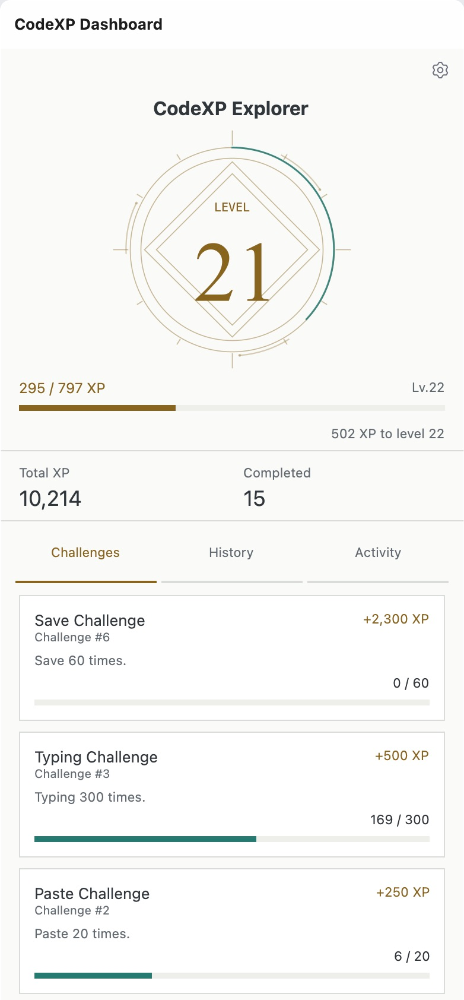
  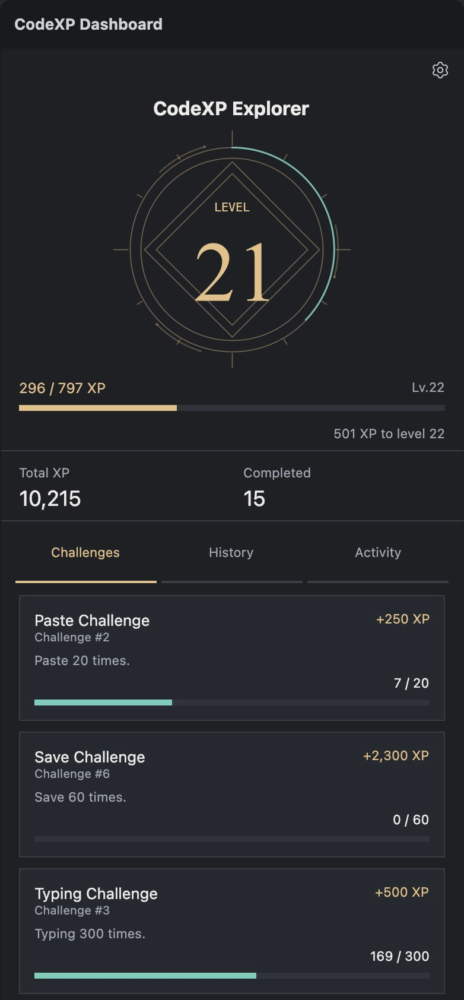

**History** is always available in its own tab, with the latest completion first. Each entry keeps its own completed challenge number and reward. **Activity** shows the XP value and recorded count for each kind of event.

History and Activity in light and dark themes

  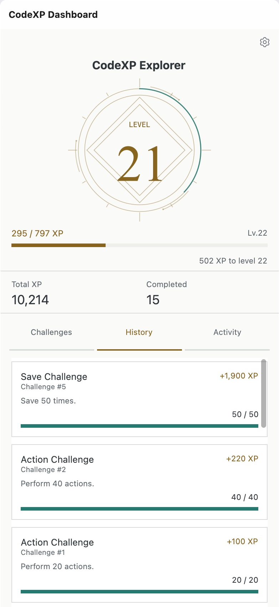
  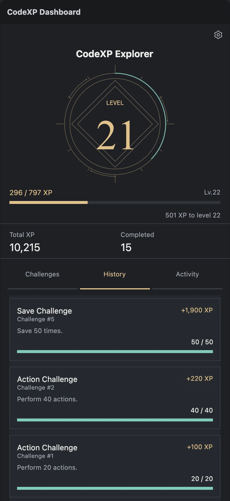

  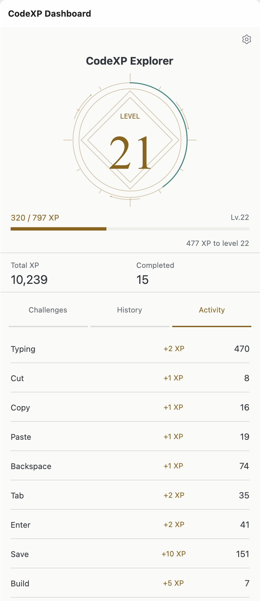
  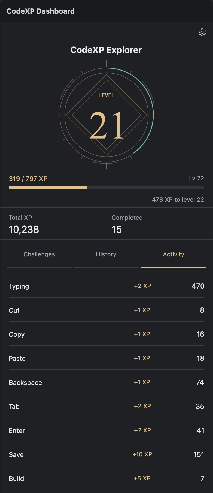

## XP where the action happens

Typing and editor commands show small XP labels near the caret. Save, Build, Run, Debug, and other menu or toolbar actions show XP at the bottom center of the project window, including when no editor is open. In multiple projects, the effect stays with the window where the action occurred.

  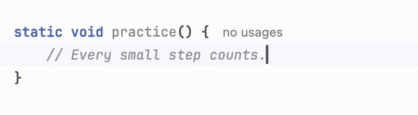

  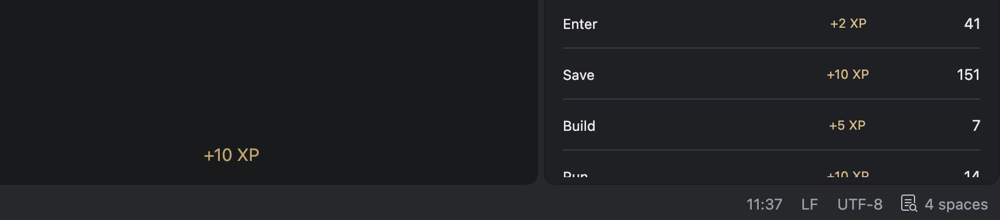

Watch Save XP appear in the project window

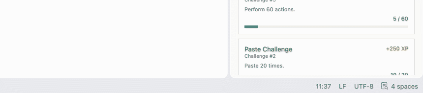

The clips use a demo IDE and a lower frame rate than the live effects. [Still image of caret XP](images/2.2.0/xp-caret.png).

## Achievement effects and preferences

The dashboard gear opens **Settings/Preferences → Tools → CodeXP**.

New installations use **CodeXP Notification**, **Celebratory** effects, and XP labels. **Subtle** uses quieter decoration. **Reduce motion** keeps results visible without movement, scaling, or particles; the macOS Reduce motion preference is also respected. Dashboard values update immediately in every style.

  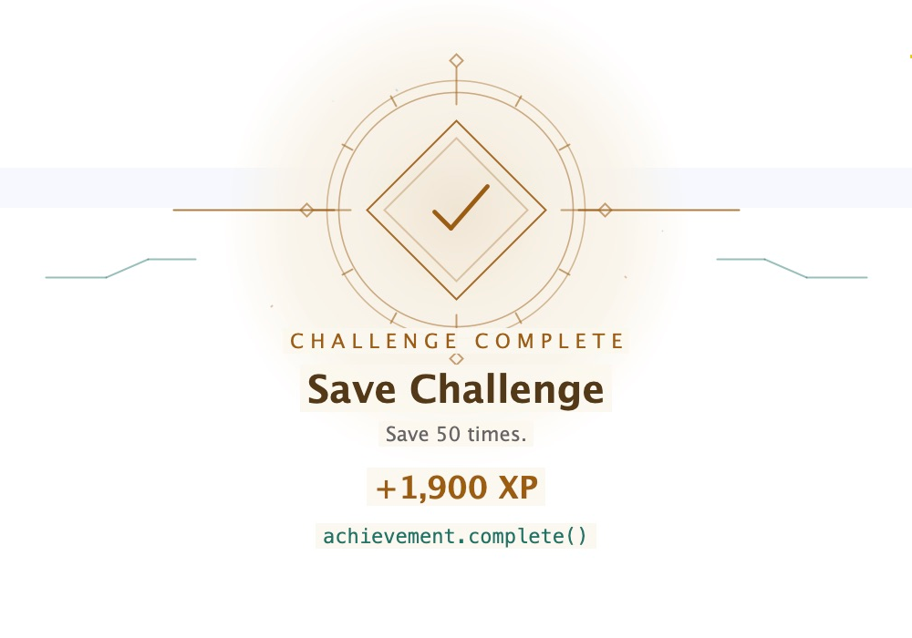
  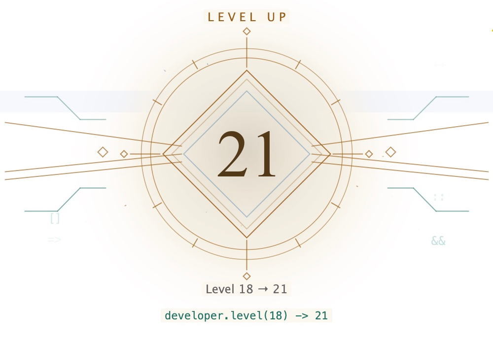

Watch a challenge completion and level-up transition

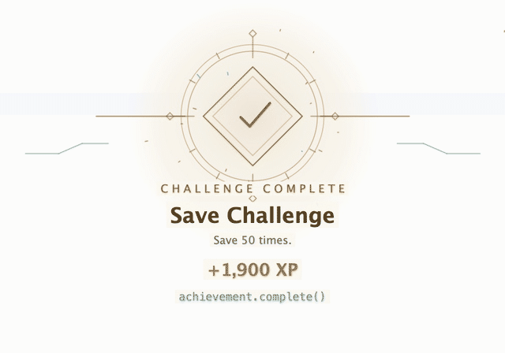

You can select **IntelliJ Notification** for standard IDE notifications, or independently turn off level-up notifications, challenge-completion notifications, and gained-XP labels. Upgrades keep these choices, so an existing disabled effect is not automatically enabled.

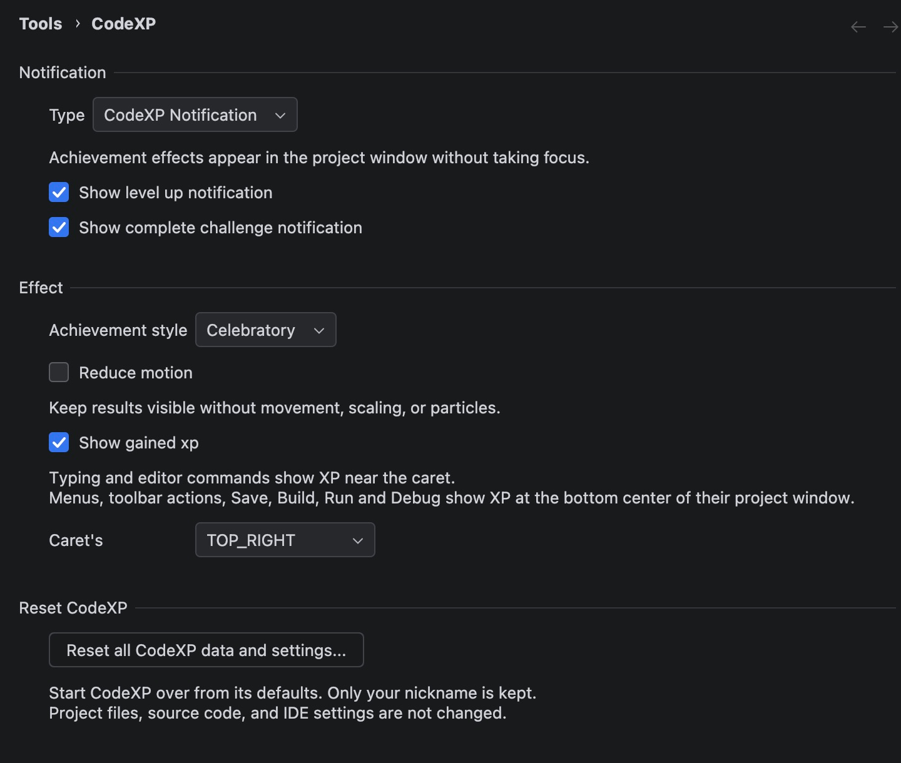

## Upgrading from 2.1.1 to 2.2.0

Update the plugin and restart the IDE. No manual database migration, export/import, or reset is required. The same local `CodeXP.xml` storage keeps your nickname, XP, event counts, active challenges, completion history, and existing notification preferences. New effect options receive their defaults.

The old completed-challenge visibility checkbox is replaced by the always-available **History** tab. Older saves have no recent-event ordering data, so that ordering starts with new activity after the update. Challenge numbers are derived from the existing goal and reward progression; unrecognized records are shown without an invented number.

## Starting over

**Reset all CodeXP data and settings…** opens a confirmation dialog. Confirming permanently resets XP, level, challenge stages and progress, rewards, History, Activity counts, ordering, and CodeXP preferences. **Only your nickname is kept.** Cancel leaves everything unchanged. Project files and IDE settings are unaffected.

## Contributing

CodeXP is open source and welcomes focused contributions. See [CONTRIBUTING.md](CONTRIBUTING.md) for local setup, validation commands, and release policy.

---

Plugin based on the [IntelliJ Platform Plugin Template](https://github.com/JetBrains/intellij-platform-plugin-template).
