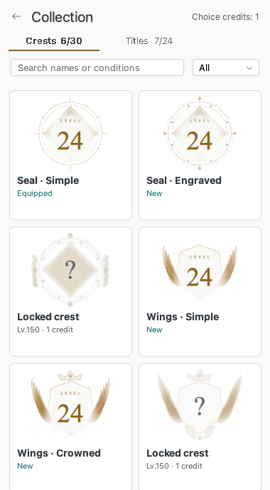
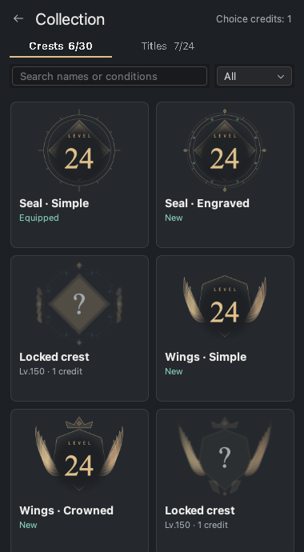
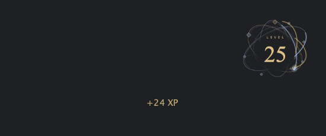

#  CodeXP

<!-- Plugin description -->
Turn everyday coding into XP, challenges, and levels in your JetBrains IDE.

CodeXP awards XP for typing, cut/copy/paste, backspace, tab, enter, saving, building, running, debugging, and other IDE actions. Each kind of activity has its own challenges, with harder goals and larger rewards as you complete them.

- Follow your level and real XP progress in a crest dashboard that adapts to light and dark themes.
- Collect 30 crests and 24 titles through levels, completed challenges and choice credits. Discover locked silhouettes and choose what to equip yourself.
- See recently updated challenges first, with gentle card movement, progress bars, rewards, and a separate challenge number for each kind of activity.
- Browse every completed challenge in History and your event counts in Activity.
- See typing and editor-command XP near the caret, and menu/toolbar action XP at the bottom center of the project window.
- Celebrate completions and level ups with CodeXP effects, or keep standard IntelliJ notifications. Choose Subtle or Celebratory effects and Reduce motion.

Progress is stored locally in your IDE profile and shared by projects opened in that IDE instance. Existing progress and notification preferences are preserved when upgrading.
<!-- Plugin description end -->

## Installation

In **Settings/Preferences → Plugins → Marketplace**, search for **CodeXP** and install it. Alternatively, download the ZIP from the [latest release](https://github.com/ByteAurora/intellij-codexp/releases/latest), then choose **Plugins → ⚙️ → Install Plugin from Disk…**. Restart the IDE when prompted.

Supports IntelliJ Platform versions **2023.3 through 2026.2**.

## Collections and growth in 2.3.0

Version **2.3.0** adds collections, a mini crest, and a level-150 progression path with rewards beyond MAX.

Open **Collection** from the dashboard to browse crests and titles, search unlock conditions, or filter owned and locked items. The collection follows the IDE language and supports English and Korean. Locked names stay hidden behind blurred artwork and a question mark. Acquiring an item does not equip it: select **Equip** to apply it. Equipment is shared across project windows in the same IDE profile.

Owned items animate directly in the collection grid. Selecting an item, including selecting it again, immediately emphasizes its animation and opens inline acquisition or equipment controls while the list stays visible. Each crest family combines distinct motion motifs, with different paths and rhythms across its three forms. Subtle effects use quieter motion; Reduce motion keeps the artwork still. Only viewing an item marks it as seen. Choose **선택권 1개로 획득 (Acquire for 1 credit)**, **장착 (Equip)**, or **장착 해제 (Unequip)** explicitly; selection alone never spends a credit or changes equipment. The **선택 가능 (Available choices)** filter shows items you can currently acquire.

  
  

When the dashboard is closed, an equipped crest can stay visible in a transparent **mini crest** at the bottom right of the IDE. Your current level appears in its center and updates when you level up in any project. Drag the crest to move it at any time, including when it overlaps the caret or XP text. Right-click the crest (or Control-click on Mac), or run **CodeXP Mini Crest Options** from **Find Action**, to choose 96, 128, 164, or 256 px or hide it. **Settings → CodeXP → Mini crest** can enable it and restore its position. The crest dims near the caret, XP text or completion but remains draggable. Context menus, Settings and other dialogs belonging to the same IDE keep it visible behind them without covering their controls; achievement celebrations temporarily hide it. Newly earned choice credits and successful crest equipment have their own brief celebration, using the equipped crest’s colors and motion.

The dashboard shows the collection entry separately from the passive choice-credit balance. Its crest and background keep moving while the dashboard is visible, even when another app or project has focus. Hiding the dashboard or minimizing its window pauses the animation. The collection and mini crest also pause when their window is inactive. All three share an animation clock and respect Reduce motion. Frame delivery depends on the display and IDE workload.

Levels end at **150 MAX**. On a new profile the first level-up takes **900 XP**. Level requirements grow to a ceiling of **15,000 XP per level**, and level 150 takes **1,651,968 cumulative XP**. Challenge goals, action XP and challenge rewards are unchanged. For example, typing alone earns 300 XP after 100 keystrokes (including the first challenge); the second typing challenge brings you to level 2 at 300 keystrokes.

After level 150, the first choice credit requires **50,000 newly eligible XP**. Each earned credit raises the next requirement by **5,000 XP**, up to **100,000 XP** from the 11th credit onward. Spending credits does not lower the requirement, and the migration gift does not raise it. Large challenge rewards can earn multiple credits; all leftover XP carries forward without daily limits. One credit acquires one of the ten choice crests or eight choice titles. Automatic challenge rewards use the highest **completed challenge number of any one activity**, not the number currently in progress or a sum across activities.

## Updating an existing profile to 2.3.0

Your cumulative XP, active challenges, History, Activity counts, nickname and preferences are preserved. The update grants every eligible level and completed-challenge collection reward once, without changing your equipment or replaying earlier celebration effects. Existing profiles with XP receive **one transition choice credit**. A single acknowledgement dismisses the update summary across project windows.

The current level uses the new curve and stops at 150. A one-time adjustment preserves the value of XP already earned toward levels under the earlier capped progression; it is not an XP grant and is never included in your activity total or spent as choice credits. New XP uses the slower pace. If the 2.2.0 formula gave a level above 150 at migration, the previous-formula level remains visible separately.

For example, a returning player with **450 total XP** keeps level 2 and about 48% progress toward level 3. Their total still reads **450 XP** and they need **495 more XP** for level 3. A new player with the same total is halfway to level 2.

Because 2.2.0 did not cap the per-level cost, some high-level profiles can display a higher level after recalculation. For example, **215,902 total XP** was level 75 in 2.2.0 and becomes level 83 on migration, without changing the XP balance.

Historical excess XP is retained but is **not converted into a stockpile of credits**. A profile already at MAX on migration from 2.2.0 earns its first post-cap credit after another 50,000 XP; a profile below the cap starts earning credit progress when it reaches its adjusted cap. Updating an earlier 2.3.0 candidate settles its earned credits at the old rate, preserves spending and actual XP toward the next credit, and uses the earned post-cap count to set the next requirement. Existing partial progress is not discarded or multiplied.

Collection ownership, spending and migration records are saved separately from the legacy profile, so opening 2.2.0 does not erase them. Keep the whole IDE configuration when backing up CodeXP. If collection storage cannot be read safely, CodeXP stops collection changes instead of issuing rewards again. Reset also invalidates older profile backups; progress made in 2.2.0 after a reset can be recognized through the new challenge records.

## Dashboard

The dashboard, History, Activity and settings captures below illustrate the 2.2.0 layout. The collection previews above are from 2.3.0.

Open **CodeXP Dashboard** from the tool-window bar. Edit your nickname at the top; the crest, XP bar, and totals reflect your current progress immediately.

**Challenges** shows one active challenge per activity. `Challenge #3` means the third challenge of that kind, independently of other kinds and of its position in the list. Recently updated cards move toward the top; scrolling through a long list keeps your reading position.

  
  

**History** is always available in its own tab, with the latest completion first. Each entry keeps its own completed challenge number and reward. **Activity** shows the XP value and recorded count for each kind of event.

History and Activity in light and dark themes

  
  

  
  

## XP where the action happens

Typing and editor commands show small XP labels near the caret. Save, Build, Run, Debug, and other menu or toolbar actions show XP at the bottom center of the project window, including when no editor is open. In multiple projects, the effect stays with the window where the action occurred.

When a mini crest is visible, XP events send streaks toward its center and briefly light up its outline. Rapid input is grouped to keep typing responsive. Reduce motion leaves just the label. Preview from the 2.3.0 renderer:

  

  

Watch Save XP appear in the project window

The clips use a demo IDE and a lower frame rate than the live effects. [Still image of caret XP](images/2.2.0/xp-caret.png).

## Achievement effects and preferences

The dashboard gear opens **Settings/Preferences → Tools → CodeXP**.

New installations use **CodeXP Notification**, **Celebratory** effects, and XP labels. **Subtle** uses quieter decoration. **Reduce motion** keeps results visible without movement, scaling, or particles; the macOS Reduce motion preference is also respected. Dashboard values update immediately in every style.

  
  

Watch a challenge completion and level-up transition

You can select **IntelliJ Notification** for standard IDE notifications, or independently turn off level-up and choice-credit notifications, challenge-completion notifications, and gained-XP labels. Upgrades keep these choices, so an existing disabled effect is not automatically enabled.

## Upgrading from 2.1.1 to 2.2.0

Update the plugin and restart the IDE. No manual database migration, export/import, or reset is required. The same local `CodeXP.xml` storage keeps your nickname, XP, event counts, active challenges, completion history, and existing notification preferences. New effect options receive their defaults.

The old completed-challenge visibility checkbox is replaced by the always-available **History** tab. Older saves have no recent-event ordering data, so that ordering starts with new activity after the update. Challenge numbers are derived from the existing goal and reward progression; unrecognized records are shown without an invented number.

## Starting over

**Reset all CodeXP data and settings…** opens a confirmation dialog. Confirming permanently resets XP, level, challenge stages and progress, rewards, History, Activity counts, ordering, CodeXP preferences, collections, equipment, choice credits and migration progress. The default level-1 crest becomes available again as on a fresh profile. **Only your nickname is kept.** Cancel leaves everything unchanged. If saving the reset fails, existing records remain intact. Project files and IDE settings are unaffected.

## Trying the local Mac release candidate

After building with `./gradlew buildPlugin`, run `bash scripts/run-release-candidate.sh`. It opens **CodeXP 2.3.0 RC** with a separate synthetic 2.2.0 profile and two small Kotlin projects under `build/release-candidate/user`. The plugin runs in normal product mode. It does not read or migrate your usual IDE profile, and it does not close your other IDEs. Running it again preserves the RC test progress. Close that RC IDE before applying a different build.

For a separate collection-motion test app, run `bash scripts/run-release-candidate.sh collection-motion large-reward --measure-animation`. This preserves the earlier RC app and records completed collection paint intervals and paint duration in the new app's isolated `log/idea.log`; these measurements are not monitor presentation timestamps.

## Contributing

CodeXP is open source and welcomes focused contributions. See [CONTRIBUTING.md](CONTRIBUTING.md) for local setup, validation commands, and release policy.

---

Plugin based on the [IntelliJ Platform Plugin Template](https://github.com/JetBrains/intellij-platform-plugin-template).
